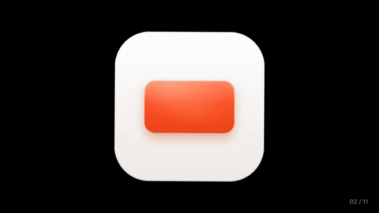
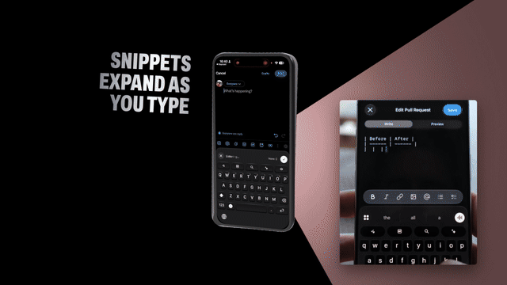
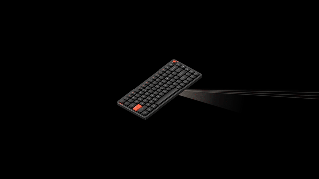
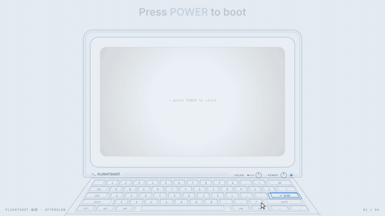
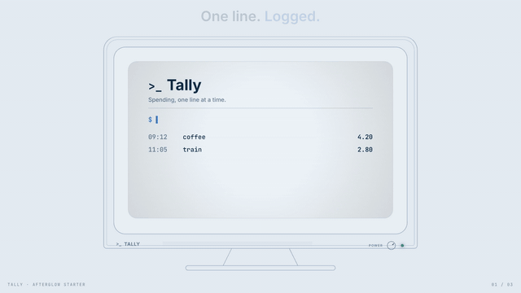

# skills

A collection of Yen's agent skills for making product films, rendered frame by frame from code.

## Install

```bash
npx skills add ridemountainpig/skills
```

Or install one skill with `--skill <name>`, or copy its folder from [`skills/`](skills) into `~/.claude/skills/`.

| Skill | Makes | Best for |
| --- | --- | --- |
| [spotlight-film](#spotlight-film) | Keynote-style launch films: a black stage, beams of light, giant oblique type, hard cuts | Launches and feature films for any product |
| [afterglow](#afterglow) | Retro-device demo films and posters: a glowing terminal or monitor that runs your product's UI | Developer tools, CLIs, APIs and apps you understand by watching them used |

## Skills

### spotlight-film

Turns a product brief into a rendered, keynote-style product film: a black stage, one anchor whose beams of light
carry content out at different angles, giant oblique type and hard-cut proof shots. Every frame is rendered from
code (HTML + three.js, Playwright, ffmpeg), so films are deterministic and reviewable frame by frame.

| open-slide (47 s) | Raycast Keyboard for iOS (40 s) | Raycast Keyboard (40 s) |
| --- | --- | --- |
| [](docs/demos/open-slide.mp4) | [](docs/demos/raycast-ios-keyboard.mp4) | [](docs/demos/raycast-keyboard.mp4) |

Click a preview for the full film. These are unofficial fan films made to test the skill, not affiliated with the
brands shown. Their soundtracks were added for the showcase: this skill renders picture only.

Try: "Make a 30-second launch film for our app. Here's the README, three screenshots and a screen recording of the
new editor."

Claude plans the film with you, renders stills for review, then the preview and the final MP4 (silent, ready for
your own music). It works with the material you supply: it won't invent people, places or footage.

```bash
npx skills add ridemountainpig/skills --skill spotlight-film
```

[`skills/spotlight-film/SKILL.md`](skills/spotlight-film/SKILL.md)

### afterglow

Makes short product demo films and matching posters in a retro-device style: a line-drawn terminal or monitor whose
glowing screen runs the real product UI, driven chapter by chapter by a cursor, typed keys, a POWER button and a
COLOR knob, with one captioned verb per chapter. Comes in several looks (amber, green, white and cyan CRT, e-paper,
or one tinted from your brand colour) and renders a 16:9 film plus hero, square, story and triptych posters. Unlike
spotlight-film, it also writes its own original sound track and normalises loudness.

| FlightShot, with a knob chapter (24 s) | Tally starter, monitor (19 s) |
| --- | --- |
| [](docs/demos/afterglow-flightshot.mp4) | [](docs/demos/afterglow-tally.mp4) |

Both demos use a light, cool custom look (pale ice-blue stage, deep blue ink) added through `reel({ looks })`.

Tally is a fictional product used by the starter template.

Try: "Make a 20-second afterglow film of our CLI, in green, from the README and these two screenshots." or
"Make a hero poster and a story poster of our app in the paper look."

```bash
npx skills add ridemountainpig/skills --skill afterglow
```

[`skills/afterglow/SKILL.md`](skills/afterglow/SKILL.md)

## Which one?

Use **spotlight-film** for a launch: mood, scale and fast cuts. Use **afterglow** when the product is understood by
watching someone use it: one device, a few chapters, one action and one result each.

## License

[MIT](LICENSE)
